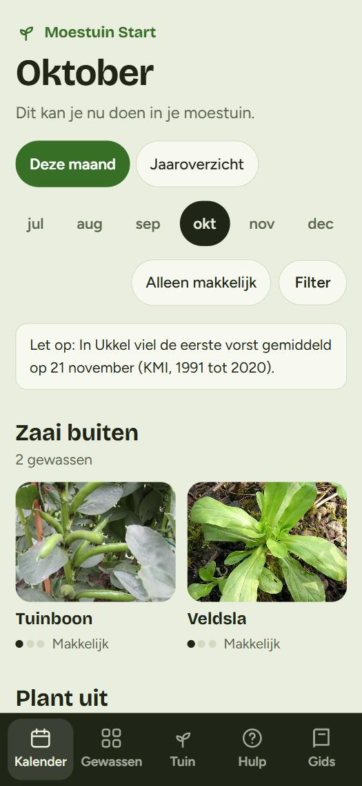
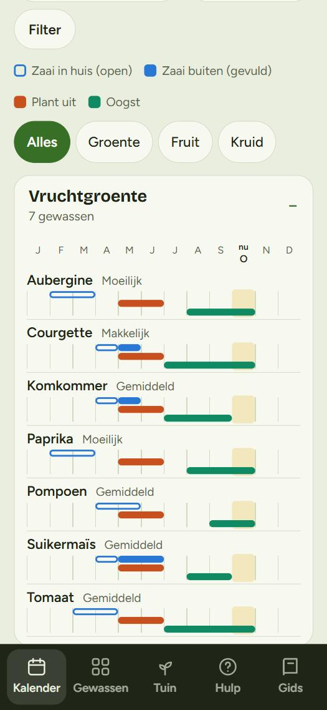
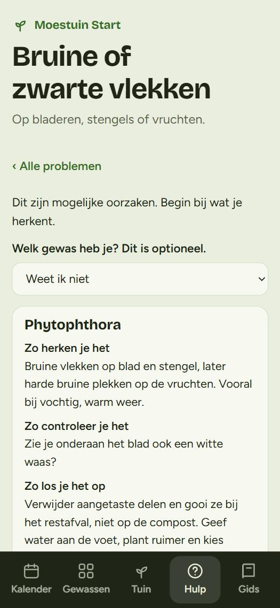
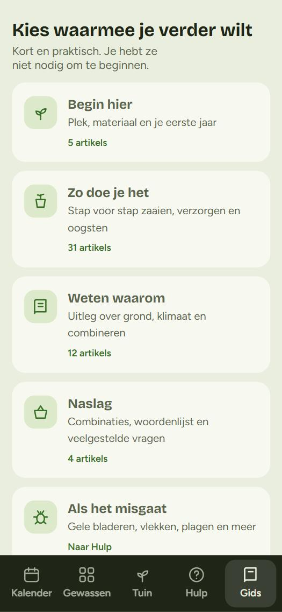

<div align="center">

# Mijn Moestuin

**Een rustige, Nederlandstalige moestuingids voor beginners.**
Wat kan ik nu zaaien, hoe doe ik dat, en wat als het misgaat?

[**Bekijk de live versie**](https://gtallpulse-hash.github.io/Mijn-Moestuin/) &nbsp;·&nbsp; [Aan de slag](#lokaal-draaien) &nbsp;·&nbsp; [Werkwijze](#werkwijze-en-branches) &nbsp;·&nbsp; [Bronnen](#bronnen-en-betrouwbaarheid)

<br>

<table>
  <tr>
    <td align="center" width="25%"><br><sub><b>Deze maand</b><br>Wat je nu kunt zaaien, planten en oogsten</sub></td>
    <td align="center" width="25%"><br><sub><b>Jaaroverzicht</b><br>Het hele jaar per gewas in één balk</sub></td>
    <td align="center" width="25%"><br><sub><b>Hulp</b><br>Kies wat je ziet, krijg mogelijke oorzaken</sub></td>
    <td align="center" width="25%"><br><sub><b>Gids</b><br>Uitleg per taak, geen overvolle lijst</sub></td>
  </tr>
</table>

</div>

---

## Waar gaat het over?

Mijn Moestuin helpt iemand die nog nooit groenten heeft gekweekt om **een eerste moestuinseizoen te overleven**. De app is bewust klein en rustig gehouden: eerst één antwoord op *wat kan ik nu doen?*, en pas daarna de details.

Het is één statische webpagina. Er is geen account, geen server en geen volgsysteem nodig.

## Wat kan het?

| Onderdeel | Wat je ermee doet |
|---|---|
| **Kalender** | *Deze maand* toont per fase (zaai in huis, zaai buiten, plant uit, oogst) wat nu kan. *Jaaroverzicht* toont het hele jaar per gewas. |
| **Gewassen** | 59 groenten, kruiden en fruit in 11 groepen. Zoeken werkt ook op andere namen: *zucchini* vindt courgette, *patat* vindt aardappel. |
| **Tuin** | Zet gewassen in je eigen tuin, vink de taken van deze maand af en maak een back-up van je gegevens. |
| **Hulp** | Kies wat je ziet (gele bladeren, bruine vlekken, gaten in het blad, enzovoort) en krijg mogelijke oorzaken en wat je kunt doen. Geen schijnzekerheid. |
| **Gids** | De Startersgids in 13 hoofdstukken, plus 60 korte artikels in vier groepen: *Ik begin net*, *Ik wil aan de slag*, *Ik wil begrijpen waarom* en *Ik zoek iets na*, met een zoekveld bovenaan. Plagen en ziektes staan bij Hulp. |

## Uitgangspunten

- **Eén primaire taak per scherm.** Details staan achter een tik, nooit tussen de kerninformatie.
- **Eerlijk over onzekerheid.** Periodes in plaats van exacte data, en "mogelijke oorzaak" in plaats van een stellige diagnose.
- **Kleur is nooit de enige drager.** De kalenderkleuren zijn gevalideerd voor kleurenblindheid. Een open balk betekent *zaai in huis*, een gevulde balk *zaai buiten*.
- **Toegankelijk.** Alle knoppen zijn minstens 44 px hoog, het contrast is gecontroleerd, het werkt met toetsenbord en op een smal scherm van 320 px, en er is een lichte en een donkere modus.
- **Privacy.** Je tuin staat alleen in je eigen browser (`localStorage`) en wordt nergens naartoe gestuurd. Er is geen tracking. Het enige externe verzoek is het ophalen van de lettertypes bij Google Fonts.

## Lokaal draaien

Er is geen build nodig. Je hebt alleen Python (of een andere eenvoudige webserver) nodig.

```bash
git clone https://github.com/gtallpulse-hash/Mijn-Moestuin.git
cd Mijn-Moestuin
python -m http.server 8000 --bind 127.0.0.1
```

Open daarna <http://127.0.0.1:8000/moestuin-start/index.html>.

> Open `index.html` liever niet rechtstreeks via dubbelklikken. De foto's en de tests werken het best via een lokale server.

## Mapstructuur

```text
Mijn-Moestuin/
├── index.html                  Doorverwijzing naar de app (voor GitHub Pages)
├── moestuin-start/
│   ├── index.html              De hele app: HTML, CSS en JavaScript
│   └── images/                 59 gewasfoto's (WebP)
├── tests/
│   ├── static_checks.py        Statische controles op index.html
│   └── browser_checks.js       Gedragscontroles die in de pagina draaien
└── docs/
    ├── img/                    Schermafbeeldingen voor deze README
    └── superpowers/
        ├── specs/              Ontwerp en acceptatiebewijs
        └── plans/              Implementatieplan
```

## Testen

```bash
# Statische controles (labels, kleurwaarden, opgeslagen sleutels, geen plaatshouders)
python -I tests/static_checks.py
```

De gedragscontroles draaien in de pagina zelf, met de pagina geladen via een lokale server vanaf de **hoofdmap** van de repo (niet vanuit `moestuin-start`). Voer dit uit in de console van de browser:

```js
const m = await import('/tests/browser_checks.js');
JSON.stringify(await m.runAll());
```

De controles dekken onder meer: de tabs en weergaven, de hints per maand, zoeken, de 60 artikels, de bronregels en de aanraakdoelen. Daarnaast hoort er een toegankelijkheidsscan met [axe-core](https://github.com/dequelabs/axe-core) bij (`m.axeViolations()`).

## Werkwijze en branches

| Branch of tag | Doel |
|---|---|
| `main` | De stabiele versie. Die staat live. |
| `v1-stabiel` (tag) | Vaste terugvalpositie: de werkende versie vóór de herbouw van Kalender en Gids. |
| `test` | Hier wordt nieuw werk gebouwd en getest. Pas samenvoegen met `main` als het is goedgekeurd. |

Grotere wijzigingen volgen een vaste cyclus: onderzoek, ontwerp, goedkeuring, een klein plan en daarna uitvoering met tests en een onafhankelijke controle. Het ontwerp en het plan van de laatste ronde staan in [`docs/superpowers`](docs/superpowers).

## Bronnen en betrouwbaarheid

Teeltadvies moet controleerbaar zijn. Daarom staat onderaan de herziene artikels een regel met **bron** en **nagekeken-maand**, en alleen als die echt is ingevuld. Gebruikte bronnen zijn onder meer:

- [KMI](https://www.meteo.be/) en [KNMI](https://www.knmi.nl/) voor vorst en de ijsheiligen
- [IVN](https://www.ivn.nl/), [Velt](https://www.velt.nu/), [Hubo](https://www.hubo.be/) en [Leefmilieu Brussel](https://leefmilieu.brussels/) voor zaaien, water geven en slakken
- [RHS](https://www.rhs.org.uk/) voor phytophthora
- [UC Master Gardener](https://ucanr.edu/) voor kiemtemperaturen

Niet elk artikel is al aan een bron getoetst. Waar dat niet gelukt is, staat er bewust geen bronregel. De gegevens zijn gemiddelden en geen garantie voor jouw tuin. Het zaadzakje blijft altijd de baas.

## Foto's

De foto's komen van [Wikimedia Commons](https://commons.wikimedia.org/) met vrije licenties. In de app staat bij elke foto de fotograaf en een link naar de bron.

## Beperkingen

- Je tuin staat alleen in je browser op dat toestel. Wis je browsergegevens of gebruik je een ander toestel, dan is hij weg. Gebruik daarom af en toe **Bewaar back-up** in de tab Tuin.
- Er is nog geen echte test met beginners uitgevoerd. De bevindingen komen uit onderzoek en automatische controles, niet uit gebruikersonderzoek.
- Automatische toegankelijkheidscontroles vinden maar een deel van de problemen. Een test met een schermlezer is nog niet gedaan.

## Ideeën voor later

Dit zijn ideeën, geen beloftes:

- Een plantdatum per gewas, zodat taken uit de groeifase komen in plaats van uit de kalender
- Een "Welkom terug"-scherm dat achterstallige taken rustig opnieuw plant
- Eigen webadressen voor artikels en gewassen, zodat ze vindbaar zijn
- Een deelbare afbeelding van je eerste moestuinplan

## Licentie

Er is nog geen licentie gekozen. Tot dat gebeurt, blijven alle rechten bij de auteur. De foto's hebben elk hun eigen licentie.
